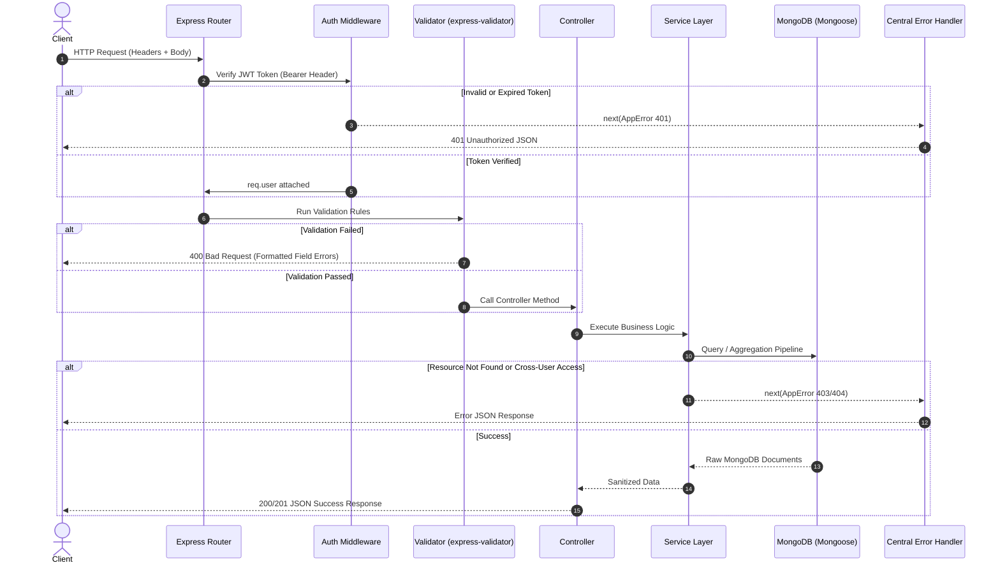
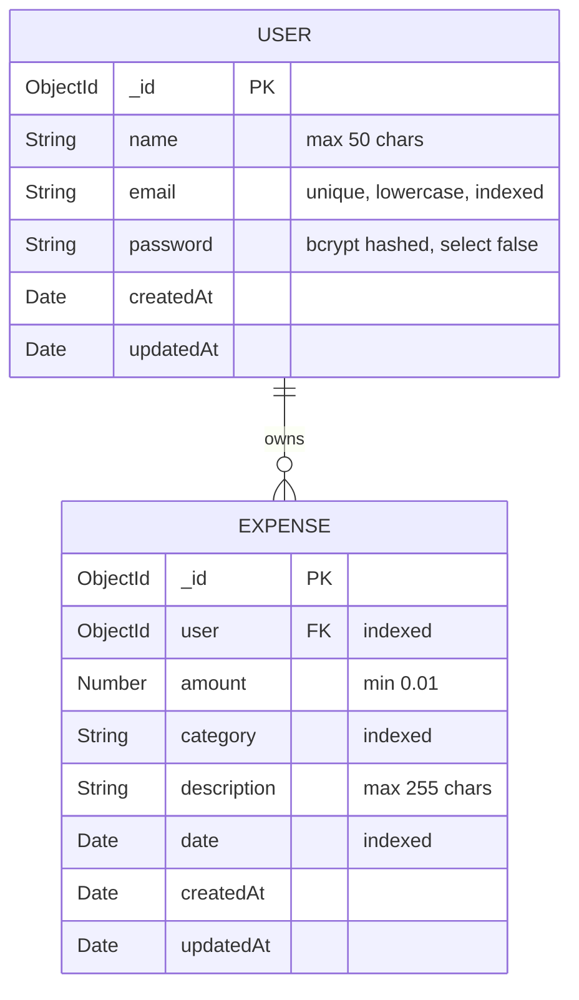

# Expense Tracker REST API

[](https://github.com/Kaushtubha/expense-tracker-api/actions/workflows/test.yml)


A production-grade, secure, and scalable RESTful API for personal expense management built with **Node.js**, **Express.js**, and **MongoDB**. Designed following clean architecture principles with complete separation of concerns, strict multi-tenant data isolation, centralized error handling, comprehensive test automation, and Docker containerization.

---

## Table of Contents
- [System Architecture & Diagrams](#system-architecture--diagrams)
  - [High-Level System Architecture](#high-level-system-architecture)
  - [Request-Response Lifecycle](#request-response-lifecycle)
  - [Database Schema (ER Diagram)](#database-schema-er-diagram)
- [Key Features](#key-features)
- [Tech Stack](#tech-stack)
- [Project Directory Structure](#project-directory-structure)
- [Getting Started](#getting-started)
  - [Prerequisites](#prerequisites)
  - [Environment Configuration](#environment-configuration)
  - [Running Locally](#running-locally)
  - [Running with Docker Compose](#running-with-docker-compose)
- [Running Automated Tests](#running-automated-tests)
- [API Documentation & Endpoints](#api-documentation--endpoints)
  - [Authentication Endpoints](#1-authentication-endpoints)
  - [Expense Management Endpoints](#2-expense-management-endpoints)
- [Interview & Technical Defense Guide](#interview--technical-defense-guide)

---

## System Architecture & Diagrams

### High-Level System Architecture

The application adopts a **Layered Architecture (N-Tier)** separating transport routing, request validation, business logic, data access, and persistence.

```mermaid
graph TD
    Client[Client / Postman / Frontend] -->|HTTP / JSON Requests| ReverseProxy[Reverse Proxy / Docker Port 5000]
    ReverseProxy --> ExpressApp[Express App (app.js)]
    
    subgraph Middleware Pipeline
        ExpressApp --> CORS[CORS & Body Parser]
        CORS --> Morgan[Morgan Logger]
        Morgan --> AuthGuard[JWT Protect Middleware]
        AuthGuard --> Validator[express-validator Validation Chains]
    end

    subgraph Controllers & Services Layer
        Validator --> Controller[Controllers Layer (Thin handlers)]
        Controller --> Service[Services Layer (Business Logic & Aggregation)]
    end

    subgraph Persistence Layer
        Service --> MongooseModels[Mongoose Schemas (User & Expense)]
        MongooseModels --> MongoDB[(MongoDB Database)]
    end

    subgraph Error Handling System
        Validator -.->|Validation Errors| CentralError[Centralized Error Handler]
        AuthGuard -.->|Auth / JWT Errors| CentralError
        Service -.->|AppError (400, 403, 404)| CentralError
        CentralError -->|Uniform JSON Error Response| Client
    end
```

---

### Request-Response Lifecycle



---

### Database Schema (ER Diagram)



> **Index Strategy**: A compound index `{ user: 1, date: -1 }` is applied to the `Expense` collection to make user-scoped filtering, date-range searches, and monthly summaries fast and efficient.

---

## Key Features

- **JWT Authentication & Bcrypt Hashing**: Passwords salted and hashed with 12 rounds of bcrypt. Safe `toJSON` transforms prevent password leakage.
- **Multi-Tenant User Data Isolation**: Users can strictly create, list, update, or delete only their own expenses. Cross-user data access attempts return `403 Forbidden`.
- **Filtering & Pagination**: Paginated listing (`page`, `limit`) with dynamic category filtering and ISO 8601 date range filtering (`startDate`, `endDate`).
- **MongoDB Aggregation Pipeline**: `/api/expenses/summary?month=YYYY-MM` groups and calculates total spending per category and grand monthly total in a single database aggregation pass.
- **Input Validation**: Strict request sanitization on bodies, parameters, and query strings using `express-validator`.
- **Mongoose ObjectId Validation**: URL params are validated before hitting controllers to prevent cast errors.
- **Centralized Error Handling**: Uniform operational error structure with appropriate HTTP status codes (400, 401, 403, 404, 500).
- **Automated Testing**: 100% test pass rate using Jest, Supertest, and `mongodb-memory-server` for zero external test dependencies.
- **Containerization & CI/CD**: Production-ready Docker container, docker-compose orchestration with health checks, and automated GitHub Actions CI workflow.

---

## Tech Stack

| Component | Technology | Rationale |
| :--- | :--- | :--- |
| **Runtime** | Node.js (v20+ LTS) | Non-blocking, event-driven asynchronous I/O |
| **Framework** | Express.js 4.x | Fast, minimalist web framework for REST APIs |
| **Database** | MongoDB & Mongoose 8.x | Document-based data model with strict schema validation |
| **Authentication** | JSON Web Tokens (`jsonwebtoken`) | Stateless token-based auth |
| **Cryptography** | `bcryptjs` | Secure salt-and-hash password storage |
| **Validation** | `express-validator` | Express middleware wrapping `validator.js` |
| **Test Suite** | Jest & Supertest | BDD unit/integration testing with mock HTTP requests |
| **In-Memory DB** | `mongodb-memory-server` | Fast, isolated MongoDB instance for testing |
| **Containerization** | Docker & Docker Compose | Multi-container setup with health checks |
| **CI/CD** | GitHub Actions | Automated build and test on pushes and PRs |

---

## Project Directory Structure

```text
├── .github/
│   └── workflows/
│       └── test.yml             # GitHub Actions CI workflow
├── src/
│   ├── config/
│   │   └── db.js                # Mongoose connection bootstrap
│   ├── controllers/
│   │   ├── authController.js    # Thin handlers for auth endpoints
│   │   └── expenseController.js # Thin handlers for expense endpoints
│   ├── middleware/
│   │   ├── auth.js              # Bearer token verification guard
│   │   ├── errorHandler.js      # Global error handling middleware
│   │   ├── validate.js          # express-validator execution runner
│   │   └── validators/
│   │       ├── authValidators.js    # Rules for signup & login
│   │       └── expenseValidators.js # Rules for expenses CRUD & summary
│   ├── models/
│   │   ├── Expense.js           # Expense schema & compound indexes
│   │   └── User.js              # User schema, bcrypt hooks & methods
│   ├── routes/
│   │   ├── authRoutes.js        # /api/auth router
│   │   └── expenseRoutes.js     # /api/expenses router
│   ├── services/
│   │   ├── authService.js       # Signup, login & token issuing logic
│   │   └── expenseService.js    # Expense business logic & aggregation
│   ├── utils/
│   │   └── AppError.js          # Custom operational error class
│   ├── app.js                   # Express application setup
│   └── server.js                # Server entrypoint & port listener
├── tests/
│   ├── setup.js                 # In-memory MongoDB lifecycle hooks
│   ├── auth.test.js             # Auth test suite
│   └── expense.test.js          # Expense CRUD & isolation test suite
├── .dockerignore
├── .env.example                 # Environment configuration template
├── .gitignore
├── Dockerfile                   # Multi-stage production container
├── docker-compose.yml           # App + MongoDB orchestrated services
└── package.json
```

---

## Getting Started

### Prerequisites
- **Node.js** v20.x or higher
- **MongoDB** running locally on `mongodb://127.0.0.1:27017` (or Docker installed)
- **Git**

### Environment Configuration
Copy [.env.example](file:///c:/Users/kaush/OneDrive/Desktop/project/.env.example) to [.env](file:///c:/Users/kaush/OneDrive/Desktop/project/.env):

```bash
cp .env.example .env
```

Default configuration:
```env
PORT=5000
NODE_ENV=development
MONGODB_URI=mongodb://127.0.0.1:27017/expense_tracker
JWT_SECRET=your_super_secret_jwt_key_here
JWT_EXPIRES_IN=7d
```

### Running Locally

1. **Install dependencies:**
   ```bash
   npm install
   ```

2. **Start development server with live reload:**
   ```bash
   npm run dev
   ```

3. **Verify API health:**
   ```bash
   curl http://localhost:5000/health
   ```

### Running with Docker Compose

To spin up both the **Node.js API** and a **MongoDB instance** in isolated containers:

```bash
docker-compose up --build
```

The API will be accessible at `http://localhost:5000`.

---

## Running Automated Tests

The test suite runs against an isolated, in-memory MongoDB instance with automatic setup and teardown:

```bash
npm test
```

Test coverage includes:
- User signup and duplicate email rejection
- Login with correct vs incorrect credentials
- Unauthorized requests and invalid JWT tokens
- Expense creation, pagination, and date range filters
- **User Isolation Security**: verifying User B cannot read, update, or delete User A's expenses
- ObjectId parameter validation
- Monthly summary aggregation pipeline correctness

---

## API Documentation & Endpoints

### 1. Authentication Endpoints

#### Register a New User
- **Method / Route**: `POST /api/auth/signup`
- **Request Body**:
  ```json
  {
    "name": "Jane Doe",
    "email": "jane@example.com",
    "password": "Password123!"
  }
  ```
- **Response `(201 Created)`**:
  ```json
  {
    "success": true,
    "message": "User registered successfully",
    "data": {
      "user": {
        "_id": "670da483e0a158b49e048712",
        "name": "Jane Doe",
        "email": "jane@example.com",
        "createdAt": "2026-10-14T12:00:00.000Z",
        "updatedAt": "2026-10-14T12:00:00.000Z"
      },
      "token": "eyJhbGciOiJIUzI1NiIsInR5cCI6IkpXVCJ9..."
    }
  }
  ```

#### Login User
- **Method / Route**: `POST /api/auth/login`
- **Request Body**:
  ```json
  {
    "email": "jane@example.com",
    "password": "Password123!"
  }
  ```
- **Response `(200 OK)`**:
  ```json
  {
    "success": true,
    "message": "Logged in successfully",
    "data": {
      "user": {
        "_id": "670da483e0a158b49e048712",
        "name": "Jane Doe",
        "email": "jane@example.com"
      },
      "token": "eyJhbGciOiJIUzI1NiIsInR5cCI6IkpXVCJ9..."
    }
  }
  ```

---

### 2. Expense Management Endpoints
> *All expense routes require the `Authorization: Bearer <token>` header.*

#### Create an Expense
- **Method / Route**: `POST /api/expenses`
- **Request Body**:
  ```json
  {
    "amount": 42.50,
    "category": "Food",
    "description": "Lunch with teammates",
    "date": "2026-10-14T13:30:00.000Z"
  }
  ```
- **Response `(201 Created)`**:
  ```json
  {
    "success": true,
    "message": "Expense created successfully",
    "data": {
      "_id": "670da672e0a158b49e048734",
      "user": "670da483e0a158b49e048712",
      "amount": 42.5,
      "category": "Food",
      "description": "Lunch with teammates",
      "date": "2026-10-14T13:30:00.000Z",
      "createdAt": "2026-10-14T12:05:00.000Z",
      "updatedAt": "2026-10-14T12:05:00.000Z"
    }
  }
  ```

#### List Expenses (Pagination & Filters)
- **Method / Route**: `GET /api/expenses?page=1&limit=10&category=Food&startDate=2026-10-01&endDate=2026-10-31`
- **Response `(200 OK)`**:
  ```json
  {
    "success": true,
    "message": "Expenses fetched successfully",
    "data": [
      {
        "_id": "670da672e0a158b49e048734",
        "user": "670da483e0a158b49e048712",
        "amount": 42.5,
        "category": "Food",
        "description": "Lunch with teammates",
        "date": "2026-10-14T13:30:00.000Z"
      }
    ],
    "pagination": {
      "total": 1,
      "page": 1,
      "limit": 10,
      "totalPages": 1
    }
  }
  ```

#### Get Monthly Spending Summary (Aggregation)
- **Method / Route**: `GET /api/expenses/summary?month=2026-10`
- **Response `(200 OK)`**:
  ```json
  {
    "success": true,
    "message": "Monthly summary calculated successfully",
    "data": {
      "month": "2026-10",
      "totalSpent": 320.75,
      "categoriesCount": 3,
      "breakdown": [
        {
          "category": "Food",
          "totalAmount": 185.25,
          "count": 4
        },
        {
          "category": "Transport",
          "totalAmount": 85.50,
          "count": 2
        },
        {
          "category": "Entertainment",
          "totalAmount": 50.00,
          "count": 1
        }
      ]
    }
  }
  ```

#### Update an Expense
- **Method / Route**: `PUT /api/expenses/:id`
- **Request Body**:
  ```json
  {
    "amount": 55.00,
    "description": "Updated expense description"
  }
  ```
- **Response `(200 OK)`**:
  ```json
  {
    "success": true,
    "message": "Expense updated successfully",
    "data": {
      "_id": "670da672e0a158b49e048734",
      "amount": 55,
      "category": "Food",
      "description": "Updated expense description"
    }
  }
  ```

#### Delete an Expense
- **Method / Route**: `DELETE /api/expenses/:id`
- **Response `(200 OK)`**:
  ```json
  {
    "success": true,
    "message": "Expense deleted successfully",
    "data": null
  }
  ```

---

## Interview & Technical Defense Guide

During backend interviews, recruiters and engineers will ask specific architectural questions. Here is how to defend the key choices made in this project:

### 1. How does the Monthly Summary Aggregation Pipeline work?
> *"Instead of fetching hundreds of documents into Node.js memory and doing a `.reduce()`, we push the computation down into MongoDB's native C++ engine using the Aggregation Pipeline:*
> 1. **`$match`**: Filters documents strictly for the authenticated `user` within the target UTC month boundary (`date >= startDate` and `date < endDate`). This uses our compound index `{ user: 1, date: -1 }`.
> 2. **`$group`**: Groups by category (`_id: '$category'`), computing `{ totalAmount: { $sum: '$amount' } }` and `{ count: { $sum: 1 } }`.
> 3. **`$sort`**: Sorts the grouped categories by `totalAmount: -1` (highest spending first).
> 4. **`$project`**: Reshapes the output, rounds currency amounts to 2 decimal places, and strips internal identifiers."*

### 2. How is Multi-Tenant Data Isolation enforced?
> *"Data security is enforced in the service layer on every query:
> - On listing: all queries automatically inject `{ user: req.user._id }`.
> - On single read, update, and delete: the service verifies both document existence and checks `expense.user.toString() === req.user._id.toString()`. If a user attempts to access an expense belonging to someone else, the API immediately throws an `AppError` with HTTP status **403 Forbidden**."*

### 3. Why separate `app.js` and `server.js`?
> *"Separating application configuration from the server listener allows Supertest to test Express routes in-memory without binding to a physical TCP network port. This enables parallel test executions without port collisions (`EADDRINUSE`) and cleanly decouples test environments from production boot sequences."*

### 4. How are passwords secured and kept out of responses?
> *"1. Passwords are never stored in plain text. A Mongoose `pre('save')` hook hashes them using `bcryptjs` with 12 salt rounds whenever the password field is modified.
> 2. In the User schema, `select: false` prevents the password from being fetched during normal queries.
> 3. Schema `toJSON` transformation strips `password` and `__v` before any document is serialized to JSON."*

### 5. Why express-validator instead of relying only on Mongoose?
> *"Mongoose validation happens at the persistence layer (when `save()` is invoked). `express-validator` acts at the perimeter/HTTP layer. Rejecting invalid payloads at the router prevents invalid requests from ever hitting controllers, allocating database connections, or running business logic."*
