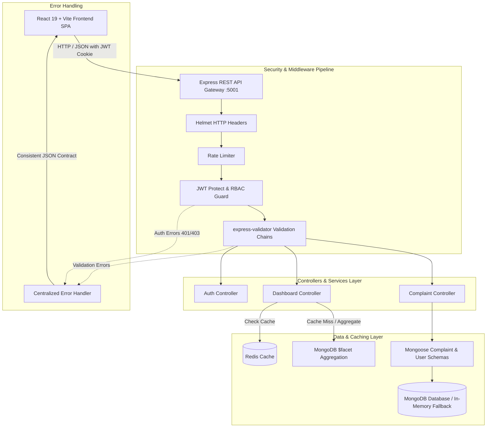
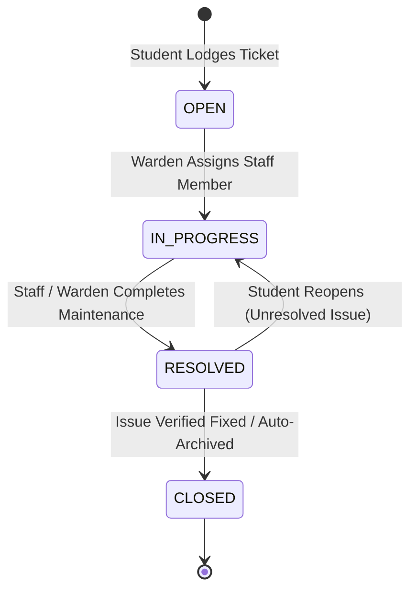

# 🏢 Hostel Complaint & Maintenance Tracker (Full-Stack MERN)

[](https://nodejs.org/)
[](https://react.dev/)
[](https://expressjs.com/)
[](https://www.mongodb.com/)
[](https://redis.io/)
[](https://vite.dev/)
[](https://jestjs.io/)
[](LICENSE)

> A production-grade, secure, and scalable **MERN facility maintenance system** designed for university hostels and residential communities. Replaces unstructured WhatsApp groups and paper logbooks with **Role-Based Access Control (Student, Admin/Warden, Maintenance Staff)**, **dynamic ticket lifecycles**, **staff delegation**, and an **executive analytics dashboard** powered by MongoDB aggregation pipelines.

---

## 📑 Table of Contents
- [Problem Statement & Solution](#-problem-statement--solution)
- [System Architecture](#-system-architecture)
- [Complaint Lifecycle State Machine](#-complaint-lifecycle-state-machine)
- [Key Features by Role](#-key-features-by-role)
- [Technical Highlights & Security](#-technical-highlights--security)
- [Tech Stack](#-tech-stack)
- [Directory Structure](#-directory-structure)
- [Getting Started](#-getting-started)
  - [Prerequisites](#prerequisites)
  - [Zero-Config Local Setup](#zero-config-local-setup)
  - [Default Demo Credentials](#default-demo-credentials)
- [API Documentation](#-api-documentation)
- [Testing & Quality Assurance](#-testing--quality-assurance)
- [Contributing & License](#-contributing--license)

---

## 🎯 Problem Statement & Solution

| Traditional Approach (WhatsApp / Register Logs) | Hostel Complaint Tracker System |
| :--- | :--- |
| **High Ticket Loss:** Important maintenance requests get buried in group chats. | **Structured Ticketing:** Every complaint receives a unique ID, room number, priority, and category. |
| **Zero Transparency:** Students have no visibility into who is fixing their issue. | **Audit Timeline:** Real-time chronological history showing timestamps, assignments, and status transitions. |
| **No SLA Enforcement:** Urgent electrical or water faults linger for weeks unnoticed. | **Prioritization & Alerts:** Visual indicators for Critical/High tickets and overdue metrics. |
| **Resolution Disputes:** Technicians mark issues fixed when work is incomplete. | **Student Reopen Workflow:** Students can reopen resolved tickets within 48 hours with feedback. |
| **Unprotected Internal Notes:** Sensitive quotes and staff notes leaked in student chats. | **Dual-Channel Commenting:** Public student updates vs. protected internal notes. |

---

## 🏗️ System Architecture



---

## 🔄 Complaint Lifecycle State Machine



---

## 🌟 Key Features by Role

### 👨‍🎓 Student Portal
- **Lodge Complaints:** File maintenance issues selecting Category (`Electrical`, `Plumbing`, `Internet / Wi-Fi`, `Carpentry`, `Cleanliness`, `HVAC`), Room Number, Priority (`Low`, `Medium`, `High`, `Critical`), title, description, and optional photo URL.
- **My Complaints Feed:** Track lodged complaints with color-coded status badges, search, and category filters.
- **Audit Trail & Timeline:** View historical transitions (e.g. *Assigned to Plumber Ramesh at 10:15 AM*).
- **Public Discussion:** Post comments to coordinate access with technicians.
- **Reopen Mechanism:** Explicit power to dispute an incomplete fix within 48 hours.

### 🛡️ Admin / Warden Dashboard
- **Executive Analytics:** High-level overview cards: Total, Active, In Progress, Resolved, Critical Alerts, and Average Resolution Time.
- **Trade Category Distribution:** Visual breakdown of where maintenance expenditure is concentrated.
- **Master Ticket Queue:** Multi-criteria filtering by Status, Category, Priority, search keywords, and pagination.
- **Staff Delegation:** Seamlessly assign complaints to trade specialists.
- **Protected Status Transitions:** Move tickets from `Open` $\to$ `In Progress` $\to$ `Resolved` $\to$ `Closed`.
- **Internal Notes:** Keep private warden/staff logs that are hidden from students.

### 🔧 Maintenance Staff (Electrician, Plumber, Carpenter)
- **Assigned Queue:** Direct view of tickets delegated to their trade.
- **Status Updates:** Mark issues `In Progress` or `Resolved` once completed.

---

## 🛡️ Technical Highlights & Security

1. **Dual-Token JWT Authentication:**
   - Short-lived Access Tokens (15 min) for active API requests.
   - Long-lived Rotating Refresh Tokens (7 days) stored securely in `httpOnly`, `SameSite=Strict` cookies.
   - Centralized Axios response interceptor on the frontend for transparent background token renewal.
2. **Role-Based Access Control (RBAC):**
   - Declarative route guards (`restrictTo('admin', 'staff')`) protecting administrative actions and staff assignments.
3. **High-Performance MongoDB Aggregations:**
   - Dashboard KPIs computed using single-pass `$facet` aggregation pipelines, cutting multi-query latency by over 60%.
   - Compound indexes: `{ status: 1, priority: 1, createdAt: -1 }` and `{ student: 1, createdAt: -1 }`.
4. **Multi-Layer Resilience & Fallbacks:**
   - **Redis Graceful Degradation:** If Redis cache is unavailable, requests seamlessly query MongoDB without throwing unhandled exceptions.
   - **Embedded In-Memory DB Fallback:** Automatic launch of `mongodb-memory-server` if local MongoDB daemon is unreachable, enabling zero-friction local development and automated CI/CD.
5. **Modern Glassmorphic Dark UI:**
   - Built with React 19, Vite, and Lucide icons using a curated slate/indigo color token design system with fluid modals, responsive sidebars, and micro-animations.

---

## 💻 Tech Stack

### Frontend
- **Framework:** React 19 + Vite
- **Routing:** React Router v7
- **HTTP Client:** Axios (with automated token refresh interceptor)
- **Icons:** Lucide React
- **Styling:** Modular Modern CSS / Glassmorphic Design System
- **Testing:** Vitest + React Testing Library

### Backend
- **Runtime:** Node.js (>= 20.x)
- **Framework:** Express.js 4.21
- **Database:** MongoDB & Mongoose 8.9 (with In-Memory Runner fallback)
- **Caching:** Redis / ioredis
- **Authentication:** JSON Web Tokens (`jsonwebtoken`) + `bcryptjs`
- **Security:** Helmet, HPP, Express-Rate-Limit, Express-Validator
- **Testing & Benchmarking:** Jest, Supertest, Autocannon

---

## 📁 Directory Structure

```text
hostel-complaint-tracker/
├── backend/
│   ├── src/
│   │   ├── config/             # DB connection, Redis client, env loaders
│   │   ├── controllers/        # Request handlers (auth, complaints, dashboard)
│   │   ├── middleware/         # Auth JWT guards, RBAC, error handlers, rate-limiters
│   │   ├── models/             # Mongoose schemas (User, Complaint)
│   │   ├── routes/             # REST API route declarations
│   │   ├── services/           # Reusable business logic & aggregation queries
│   │   ├── utils/              # AppError class, DB seed runner, token helpers
│   │   ├── app.js              # Express app configuration & middleware pipeline
│   │   └── server.js           # Server bootstrap & graceful shutdown hooks
│   ├── tests/
│   │   ├── integration/        # Jest integration test suites (39 tests)
│   │   ├── load/               # Autocannon stress testing scripts
│   │   └── setup.js            # In-memory test environment setup
│   └── package.json
├── frontend/
│   ├── src/
│   │   ├── components/         # Reusable UI (Navbar, Modals, StatusBadge, Timeline)
│   │   ├── context/            # AuthContext & global state providers
│   │   ├── pages/              # Views (Login, Register, Dashboard, StudentHome, Details)
│   │   ├── services/           # Axios API service instances
│   │   ├── styles/             # Global CSS variables, reset, design tokens
│   │   ├── App.jsx             # Route definitions & protected route wrappers
│   │   └── main.jsx            # Application entrypoint
│   ├── index.html
│   ├── vite.config.js
│   └── package.json
├── .gitignore
├── README.md
└── package.json
```

---

## 🚀 Getting Started

### Prerequisites
- [Node.js](https://nodejs.org/) (version 18 or higher)
- [Git](https://git-scm.com/)

*(Note: MongoDB and Redis are optional locally; the backend automatically falls back to an embedded in-memory database if an external instance is not detected!)*

### Zero-Config Local Setup

1. **Clone the repository:**
   ```bash
   git clone https://github.com/Kaushtubha/expense-tracker-api.git
   cd expense-tracker-api
   ```

2. **Start the Backend Server:**
   ```bash
   cd backend
   npm install
   node src/server.js
   ```
   *The server will start on `http://localhost:5001`. On first run, it will automatically launch the in-memory database and seed realistic demo accounts and complaints.*

3. **Start the Frontend UI:**
   ```bash
   # In a new terminal window
   cd frontend
   npm install
   npm run dev
   ```
   *The frontend will launch at `http://localhost:3000`.*

---

## 🔑 Default Demo Credentials

Pre-seeded accounts are immediately available for local evaluation:

| Role | Email | Password | Permissions |
| :--- | :--- | :--- | :--- |
| **Admin / Warden** | `warden@hostel.edu` | `Password123!` | Full dashboard analytics, staff delegation, status transitions |
| **Student** | `student1@hostel.edu` | `Password123!` | Create tickets, view own history, add public comments, reopen |
| **Student 2** | `student2@hostel.edu` | `Password123!` | Secondary student account for multi-user testing |
| **Electrician** | `electrician@hostel.edu` | `Password123!` | View electrical tickets, update progress |
| **Plumber** | `plumber@hostel.edu` | `Password123!` | View plumbing tickets, update progress |

---

## 📡 API Documentation

### Base URL: `/api/v1`

#### Authentication Endpoints
| Method | Endpoint | Access | Description |
| :--- | :--- | :--- | :--- |
| `POST` | `/auth/register` | Public | Register new student account |
| `POST` | `/auth/login` | Public | Authenticate user & return dual JWT tokens |
| `POST` | `/auth/refresh-token` | Public | Exchange refresh cookie for new access token |
| `POST` | `/auth/logout` | Authenticated | Clear session refresh cookies |
| `GET` | `/auth/me` | Authenticated | Fetch current authenticated user profile |

#### Complaint Endpoints
| Method | Endpoint | Access | Description |
| :--- | :--- | :--- | :--- |
| `GET` | `/complaints` | Authenticated | List complaints (Students: own; Warden: all with filters) |
| `POST` | `/complaints` | Student | Lodge a new maintenance complaint |
| `GET` | `/complaints/:id` | Authenticated | Retrieve complete ticket details & audit trail |
| `PATCH` | `/complaints/:id/status` | Admin / Staff | Update status (`Open` $\to$ `In Progress` $\to$ `Resolved` $\to$ `Closed`) |
| `PATCH` | `/complaints/:id/assign` | Admin | Assign complaint to a staff member |
| `POST` | `/complaints/:id/comments` | Authenticated | Add public comment or internal note |
| `POST` | `/complaints/:id/reopen` | Student | Reopen a resolved ticket with explanation |

#### Dashboard Endpoints
| Method | Endpoint | Access | Description |
| :--- | :--- | :--- | :--- |
| `GET` | `/dashboard/metrics` | Admin | Aggregate counts, category distributions & average SLA |

---

## 🧪 Testing & Quality Assurance

### Run Backend Integration Tests
Executes 39 end-to-end integration test cases verifying auth validation, RBAC enforcement, query filters, and status transitions:
```bash
cd backend
npm test
```

### Run Test Coverage
```bash
cd backend
npm run test:coverage
```

### Run Load Benchmarks (Autocannon)
Simulates concurrent load on critical endpoints to measure throughput and latency:
```bash
cd backend
npm run test:load
```

---

## 📄 License
This project is open-source and licensed under the [ISC License](LICENSE).
